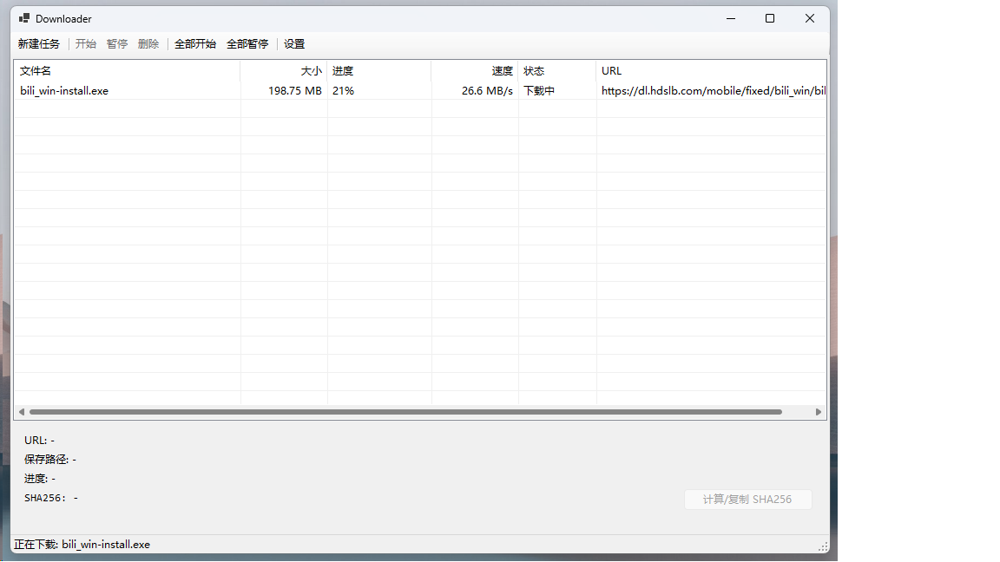

# Downloader

Downloader 是一款 Windows 上解压即用的多线程下载器：分块加速、断点续传、可限速，支持 Chrome 下载接管（自动带上 Referer 与 Cookie）、重复链接多种处理策略、SHA-256 校验，基本的常用功能几乎都涵盖了，所有数据都留在程序自己的目录里。



## 亮点

- **接管 Chrome 下载**：浏览器里点链接直接交给它，自动带上 Referer 与 Cookie —— 防盗链、需要登录的资源照下不误。
- **续传防错位**：不只记录进度，还校验 ETag / Last-Modified / 总大小 / 分片布局，服务器上的文件变过就拒绝续传，避免下出损坏文件。
- **绿色免安装**：解压即用，所有数据都留在程序自己的 `data\` 目录里，删掉即恢复出厂。
- **时间戳还原**：下载完成的文件，创建 / 修改时间与服务器上一致。

## 快速开始

1. 安装 [.NET 8 桌面运行时](https://dotnet.microsoft.com/zh-cn/download/dotnet/8.0)（已装可跳过）。
2. 解压后运行 `Downloader.exe`，点「新建任务」粘贴链接即可。
3. 想接管 Chrome 下载：**设置 → 勾选「启用 Chrome 下载接管」→ 完全退出并重启 Chrome → 首次会在提示里点一次「启用」**，之后就不用再管了。

## 功能一览

### 1. 下载引擎

- 多线程分块下载，分片数 1–32 可调（默认 8）。
- 最多 16 个任务并发下载（默认 3）。
- 全局限速，按 MB/s 设置，0 为不限速。
- 断点续传：进度自动保存，关闭程序再打开接着下。
- 续传身份校验：ETag / Last-Modified / 总大小 / 分片布局，防止服务器文件已变时续传出损坏数据。
- 分片级失败自动重试（0.5 / 1 / 2 / 4 / 8 秒退避）。
- 服务器时间戳写回。
- 重复链接五种策略：每次询问 / 添加编号副本 / 重新下载 / 续传或完成已有任务 / 跳过，并可记住选择。
- 每任务独立 Referer，随任务保存，重启后仍有效。
- SHA-256 计算与一键复制。

### 2. 浏览器接管（Chrome）

- Chrome 里点击下载链接，自动交给 Downloader 接管。
- 下载凭据透传：Referer 与 Cookie 自动带上。
- 同一站点的多个下载合并到一个弹窗里确认，不刷屏。
- 可选「弹窗显示期间即开始下载」；关闭弹窗即取消，未确认的下载会被删除。
- 探测失败时可在弹窗里指定引用页重试。
- 开关即装机 / 拆机：只写当前用户（HKCU）的注册项，不需要管理员权限，关闭后自动撤回干净。

### 3. 界面与日常

- 任务列表与详情面板：进度、速度、状态、续传说明。
- 开始 / 暂停 / 删除 / 全部开始 / 全部暂停。
- 右键菜单：打开文件夹、打开文件、复制链接、属性。
- 新建任务弹窗实时探测文件名与大小，按类型显示文件徽标。

### 4. 绿色版与数据

- 免安装，解压即用。
- 设置、任务列表、日志全部保存在程序目录的 `data\` 里，删除即恢复出厂。
- 单实例运行，重复启动只弹提示。
- 放在受保护目录（如 Program Files）时会明确提示配置无法保存。

## 使用须知

- 浏览器接管目前**只支持 Chrome（Chrome 155中实测可用）**。
- Chrome 会忽略外部程序对内部页面（如 chrome://extensions）的跳转请求，相关操作需要在浏览器里手动完成。
- 首次启用接管时，需要在 Chrome 的提示里点一次「启用」；之后重装不再需要。
- 接管启用期间，Chrome 会显示「由贵单位管理」—— 这是放行非商店扩展所必需的白名单策略，关闭开关即消失。
- 没有视频嗅探、m3u8、站点规则与定时下载。

## 构建（开发者）

- 环境：Windows 10/11，[.NET 8 SDK](https://dotnet.microsoft.com/zh-cn/download/dotnet/8.0)。
- 编译：运行 `build.ps1` 选择 Debug / Release，或直接：
  ```powershell
  dotnet build src\Downloader\Downloader.csproj -c Release
  dotnet build src\NativeHost\NativeHost.csproj -c Release
  ```
- 发布目录：运行 `tools\publish.ps1`，产物在 `dist\Downloader\`。
- 扩展改动后重新打包：`tools\pack-extension.ps1`（记得调大 `manifest.json` 的 version，否则 Chrome 不会替换旧版）。
- `extension\DownloaderHandoff.pem` 是扩展签名私钥：**丢了它扩展 ID 就会变**，所有依赖该 ID 的注册都要重来；不要把它放进分发包。

## 许可证

本项目基于 [MIT](LICENSE) 许可证发布。
